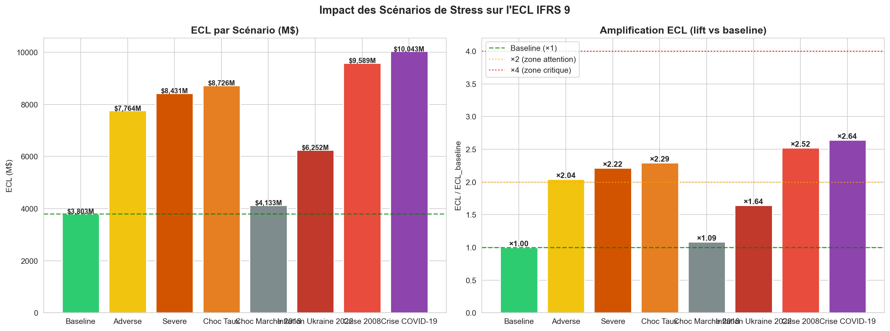

# IFRS 9 et stress testing bancaire

Moteur de calcul des pertes de crédit attendues (ECL) selon IFRS 9, appliqué à un portefeuille de prêts Lending Club, avec des stress tests macroéconomiques et un tableau de bord Streamlit.

Projet de fin d'année (PFA), ESSAI.

## Résultats

- **7 scénarios de stress** testés : adverse, sévère, choc de taux, marché 2018, inflation Ukraine 2022, crise de 2008 et crise du COVID-19.
- **Scénario le plus sévère : COVID-19**, avec des pertes attendues multipliées par **2,64** (de 3,8 à 10,0 milliards de dollars) ; la crise de 2008 les multiplie par 2,52.
- **Modèle de PD retenu : Random Forest**, avec AUC 0,693, Gini 0,386, KS 0,29 et PSI 0,067 (population stable), en validation walk-forward. La régression logistique obtient AUC 0,674.



## Démarche

1. **Exploration et préparation des données** : qualité, valeurs manquantes, taux de défaut par segment et par millésime.
2. **Modélisation PD, LGD, EAD** et calcul de l'ECL par stage IFRS 9.
3. **Modèles satellites** reliant les taux de défaut aux variables macroéconomiques (FRED : chômage, PIB, spreads, taux, inflation).
4. **Stress tests** : chocs sur PD, LGD et EAD par scénario, migrations entre stages, ECL prospective.
5. **Résilience** : impact sur le ratio CET1 et reverse stress test.
6. **Restitution** dans un tableau de bord Streamlit.

## Structure

| Dossier | Contenu |
|---|---|
| `notebooks/` | Les 8 étapes, de l'exploration (01) à la revue finale (08) |
| `src/` | Code réutilisable : préparation, moteur ECL, modèles satellites, scénarios |
| `dashboard/app.py` | Tableau de bord Streamlit |
| `outputs/` | Figures, tables de résultats et rapports |
| `tests/` | Tests de la préparation des données et du moteur de stress |
| `docs/` | Notes de travail et guide d'exécution |

## Lancer le projet

```bash
pip install -r requirements.txt
streamlit run dashboard/app.py
```

Pour les données macroéconomiques, définir la variable d'environnement `FRED_API_KEY`. Les notebooks se lancent dans l'ordre, de `01` à `08`.

## Limites

- Prototype académique, pas un outil de reporting réglementaire.
- La PD moyenne de base est élevée (45 %), car le portefeuille Lending Club est plus risqué qu'un portefeuille bancaire classique.
- Le pouvoir discriminant du modèle (AUC 0,69) et sa calibration restent à améliorer pour un usage en production.
- Les hypothèses de capital (CET1, RWA) sont pédagogiques.
